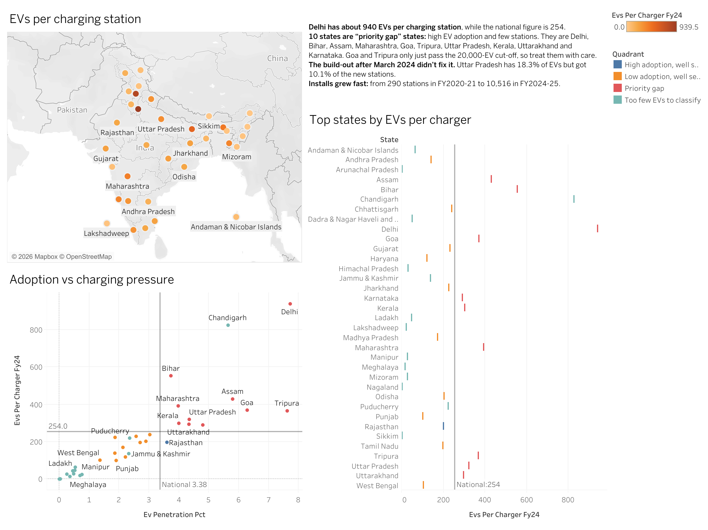
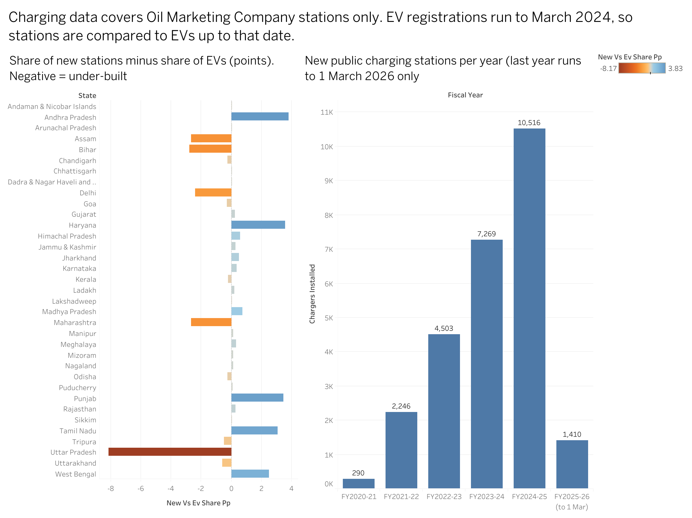

# India EV Adoption & Charging Gap Analysis

**Where is public EV charging falling behind EV adoption in India?** A state-by-state analysis of 3.6 million registered EVs and 27,737 public charging stations, using Python, SQL (SQLite) and Tableau.

**Live dashboard:** [View on Tableau Public](PASTE-YOUR-TABLEAU-PUBLIC-LINK-HERE)
**Case study:** [docs/CASE_STUDY.md](docs/CASE_STUDY.md) | **Data sources and limits:** [docs/DATA_SOURCES.md](docs/DATA_SOURCES.md)

## Dashboard preview

| Where is charging stretched? | Is the build-out catching up? |
|---|---|
|  |  |

## Questions and short answers

| Question | Short answer |
|---|---|
| Which states have the most EVs per charging station? | Delhi (about 940), Bihar (554), Assam (429), Maharashtra (392) and Goa (370). The national figure is 254. |
| Which states combine high EV adoption with thin charging? | Ten "priority gap" states: Delhi, Bihar, Assam, Maharashtra, Goa, Tripura, Uttar Pradesh, Kerala, Uttarakhand and Karnataka. |
| Did stations installed later fix this? | Not in the biggest markets. Uttar Pradesh has 18.3% of EVs but received 10.1% of stations installed after March 2024. Bihar: 5.9% of EVs, 3.1% of new stations. Assam: 4.1% and 1.5%. |
| How concentrated is it? | The five states with the most EVs hold 52.7% of EVs but 47.2% of stations. |
| How fast is the network growing? | From 290 stations installed in FY2020-21 to 10,516 in FY2024-25. |
| Are the stations working? | Puducherry has only 41% of its stations operational (24 of 58), Meghalaya 55%, Jammu & Kashmir 64%. Tamil Nadu has the most non-operational stations of any state: 609 of 2,286 (73% operational). |

## Key findings

### Charging pressure in the priority-gap states
EVs registered April 2019 to March 2024, compared with charging stations installed up to the same date.

| State | EVs | Stations | EVs per station | EVs as % of vehicles |
|---|---|---|---|---|
| Delhi | 216,084 | 230 | 939 | 7.7% |
| Bihar | 214,921 | 388 | 554 | 3.7% |
| Assam | 150,617 | 351 | 429 | 5.8% |
| Maharashtra | 439,358 | 1,120 | 392 | 4.0% |
| Goa | 20,330 | 55 | 370 | 6.3% |
| Tripura | 20,113 | 55 | 366 | 7.6% |
| Uttar Pradesh | 665,247 | 2,079 | 320 | 4.3% |
| Kerala | 151,029 | 505 | 299 | 4.0% |
| Uttarakhand | 48,522 | 165 | 294 | 4.3% |
| Karnataka | 350,810 | 1,209 | 290 | 4.8% |
| **National (35 states and UTs)** | **3,639,617** | **14,308** | **254** | **3.4%** |

Goa and Tripura only just pass the 20,000-EV cut-off used in the analysis, so read their ratios with care.

### Stations installed after March 2024 versus each state's share of EVs

| State | Share of EVs | Share of new stations | Gap (points) | New stations |
|---|---|---|---|---|
| Uttar Pradesh | 18.3% | 10.1% | -8.2 | 1,205 |
| Bihar | 5.9% | 3.1% | -2.8 | 374 |
| Assam | 4.1% | 1.5% | -2.7 | 175 |
| Maharashtra | 12.1% | 9.4% | -2.7 | 1,123 |
| Delhi | 5.9% | 3.5% | -2.4 | 423 |

Some states sped up: stations installed in Delhi rose from 100 in FY2023-24 to 344 in FY2024-25, Karnataka rose 116%, Punjab 109% and Bihar 100%.

### Stations installed per year (all states except Telangana)

| Year | Installed |
|---|---|
| FY2020-21 | 290 |
| FY2021-22 | 2,246 |
| FY2022-23 | 4,503 |
| FY2023-24 | 7,269 |
| FY2024-25 | 10,516 |
| FY2025-26 (to 1 March 2026) | 1,410 |

The sharp fall in FY2025-26 may reflect reporting timing or a real slowdown. The data cannot tell which, so it is not interpreted further.

## How the analysis works

1. **Two official government tables** (see `docs/DATA_SOURCES.md`) were transcribed to CSV and checked against the totals published in the same documents. Every total matched.
2. **State names were standardised** and the tables merged (35 states and UTs).
3. **Metrics were calculated:** EV penetration, EVs per station, each state's share of EVs and of stations, the gap between the two shares, and the share of working stations.
4. **States were classified** (only those with at least 20,000 EVs, to avoid noise from tiny states):
   - *High adoption*: EV penetration at or above the national 3.38%
   - *Thinly served*: EVs per station at or above the national 254
   - *Priority gap*: both
5. **SQL queries** (SQLite) answer the main questions using CTEs, window functions (`RANK`, `LAG`, running totals), `CASE WHEN` pivots and subqueries. They are saved in [`sql/analysis_queries.sql`](sql/analysis_queries.sql).
6. **A Tableau Public dashboard** presents the results.

| Notebook | What it does |
|---|---|
| `01_prepare_and_analyse.ipynb` | Loads and verifies the data, standardises names, merges, calculates metrics, classifies states, draws charts, saves clean files |
| `02_sql_analysis.ipynb` | Loads the clean files into SQLite and runs 8 queries |

## Repository structure

```
india-ev-charging-gap/
├── README.md
├── requirements.txt
├── docs/                  CASE_STUDY.md, DATA_SOURCES.md
├── notebooks/             01 and 02
├── sql/analysis_queries.sql
├── data/
│   ├── raw/               the two transcribed government tables
│   └── clean/             ev_state_metrics.csv, charger_installs_by_year.csv
└── dashboard/screenshots/
```

## How to reproduce

```
python3 -m venv venv
source venv/bin/activate
pip install -r requirements.txt
```

Open the folder in VS Code and run `notebooks/01_prepare_and_analyse.ipynb`, then `02_sql_analysis.ipynb`. The raw data is included.

## Limitations

- **Charging data covers Oil Marketing Company stations only** (27,737 installed). Other sources report about 52,718 charging stations in total as on 31 March 2026. States where private operators or state utilities built many chargers look more under-served here than they really are.
- **EV registrations stop at 31 March 2024.** Stations are compared with EVs up to the same date. Later stations are compared with each state's March 2024 share of EVs, which assumes that share stayed roughly stable.
- **Telangana** has no EV figure in the source table, so it is left out. **Sikkim** is recorded as "-" and treated as 0.
- **EVs of all types are counted together.** Many two- and three-wheelers charge at home or swap batteries, so "EVs per public station" measures pressure on public charging, not total demand.
- The 20,000-EV cut-off and the national benchmarks are simple choices. Different choices would change which states are labelled "priority gap".

## Next steps

- Add stations from all operators and update EV registrations to 2026.
- Split EVs by vehicle type (two-wheelers, cars, buses).
- Add highway corridors and population density.

## Data and licence note

The data comes from public Government of India documents (Press Information Bureau and the Ministry of Heavy Industries). Please check the reuse terms on those sites before redistributing.

## Tools

Python (pandas, NumPy, matplotlib), SQLite, Tableau Public, Git and GitHub.

## Author

**Mudra Berde**, final-year Data Science student. [LinkedIn](https://www.linkedin.com/in/mudra-berde-092703230/) | [GitHub](https://github.com/Mudra04)
